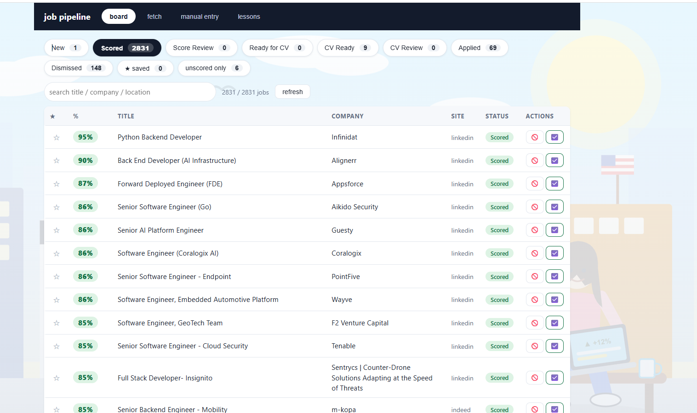
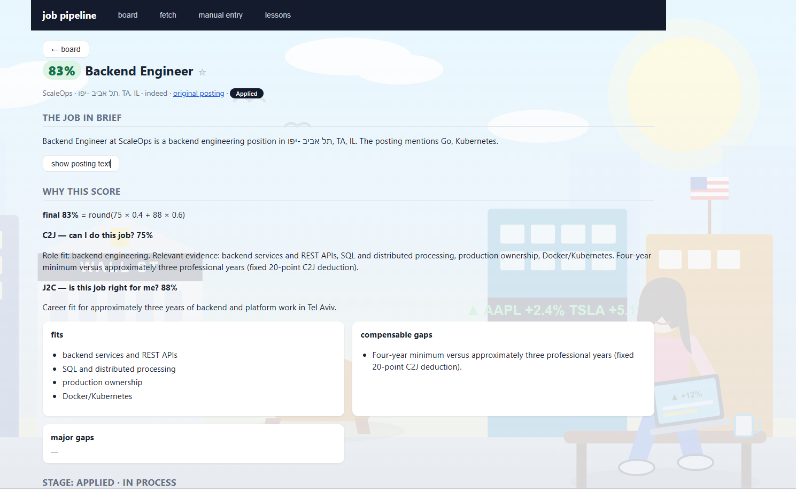

# Job Pipeline

A local workspace for finding jobs, reviewing how well they fit, tracking applications, and preparing tailored CVs. The React board and FastAPI server handle job data and workflow stages. An AI coding agent can score jobs and draft CVs when you ask it to follow the Markdown workflows in [`skills/`](skills/). No AI service or API key is built into the web app.

The defaults are set for a full-time search in Israel, but the fetch form and your private target file can be changed for your search. Job fetching uses [JobSpy](https://github.com/speedyapply/JobSpy); site availability can vary.

## Preview

| Board | Job detail |
|---|---|
| [](docs/screenshots/board.png) | [](docs/screenshots/job-detail.png) |

Screenshots show example data from a local run. Your jobs, scores, and CVs stay in your local files.

## Features

- Fetch from supported job sites with per-site isolation, page checkpoints, deduplication, and fetch history.
- Add a posting manually when a site is unavailable.
- Search and filter the board by stage, score state, and saved flag; inspect the full posting and match explanation.
- Track stages from `New` through `Scored`, review, CV preparation, `Applied`, and `Dismissed`. Record application outcomes such as interview, offer, rejection, or withdrawal.
- Ask an AI coding agent to score jobs against **your** profile and target criteria. The job detail shows separate candidate-to-job and job-to-candidate reasoning, fits, and gaps.
- Request a tailored Markdown and one-page PDF CV, review it in the job detail, and send corrections back through the score and CV feedback queues.
- Keep the SQLite database, profile, source CV notes, feedback, and generated CVs on your machine.

The app does **not** submit applications. You apply on the employer's site and record the result here.

## Requirements

- Python 3.12 and Node.js 20.19+ (or 22.12+) for local development; Git is required because `python-jobspy` is installed from GitHub.
- Or Docker with Docker Compose to run the web app in one container.
- A coding agent such as OpenCode, Codex, Claude Code, or Antigravity for the optional AI scoring and CV steps. Use your own model/account; the app does not configure one.

## Install and run

Clone the repository and open a terminal in its root:

```sh
git clone https://github.com/elchananvol/job-hunt-pipeline.git
cd job-hunt-pipeline
```

For a local Python install, create your private starter files once. This command copies only files that are missing, so it is safe to rerun. The Docker option below runs it automatically when the container starts:

```sh
python scripts/init_personal_files.py
```

Edit `personal_files/profile_brief.md`, `personal_files/target_job.md`, and the Markdown files in `personal_files/cv_sections/` with **your own** facts and preferences before asking an agent to score jobs or write CVs. The files under `examples/personal_files/` are blank prompts, not sample candidate data.

### Option A: Docker, easiest for the web app

```sh
docker compose up --build
```

Open **<http://localhost:8000>**. Docker mounts `./db` and `./personal_files`, so the database and candidate files remain on your machine. To run the AI helper scripts from an agent on the host, also install the Python dependencies as shown in Option B. Docker builds the UI and serves it through FastAPI; you do not need a separate `npm` command for this option.

### Option B: local development

Create a virtual environment and install Python dependencies from the repository root:

```sh
python -m venv .venv
```

Activate it with `.venv\Scripts\Activate.ps1` in PowerShell or `source .venv/bin/activate` on macOS/Linux, then run:

```sh
python -m pip install -r requirements.txt
python -m uvicorn server.server:app --reload --port 8000
```

In a **second terminal**, start the UI:

```sh
cd ui
npm ci
npm run dev
```

Open **<http://localhost:5173>**. The Vite dev server proxies `/api` and `/files` to the backend on port 8000. If the UI says the backend is unreachable, check the first terminal.

## Use the pipeline

1. **Fetch or add jobs.** Use the **Fetch** tab and choose a search term, sites, location, and limits. Or use **Manual entry** for a posting you already have. The CLI equivalent is `python -m server.fetch_jobs --search "software engineer" --location "israel"`; run `python -m server.fetch_jobs --help` for all options.
2. **Score.** Open your coding agent in this repository and ask: “Read `AGENTS.md` and `skills/score-job-match/SKILL.md`, then score new jobs.” Complete the private profile and target files first. Refresh the board to see scores.
3. **Review.** Search and filter the board, save interesting jobs, read each job's explanation, and add scoring feedback when a result is wrong. Ask the agent to follow `skills/apply-match-feedback/SKILL.md` to process the review queue.
4. **Prepare a CV.** Move a job to **Ready for CV**, then ask the agent to follow `skills/generate-tailored-cv/SKILL.md` for that job or the queue. The agent writes a Markdown CV and PDF under `personal_files/cv_generated/` and records their paths. Review them in the job detail. For corrections, use the CV feedback box and ask the agent to follow `skills/rework-cv/SKILL.md`.
5. **Apply and track.** Submit the application yourself, mark the job **Applied**, and update its application stage as you hear back.

The same `skills/` files are the source of truth for **Codex, Claude Code, OpenCode, and Antigravity**. `AGENTS.md` maps requests to workflows, `CLAUDE.md` and `GEMINI.md` point to it, and `.opencode/skills/` contains small OpenCode adapters. If your agent does not load project instructions automatically, use the explicit “Read ...” prompt above. Always run helper commands from the repository root.

## Data and repository layout

| Path | Purpose |
|---|---|
| `ui/` | React/Vite board and job detail UI |
| `server/` | FastAPI API, JobSpy fetcher, SQLite schema and migrations |
| `ai_helpers/` | Queue, scoring, CV bookkeeping, and PDF helper scripts for an agent |
| `skills/` | Platform-neutral AI workflows |
| `examples/personal_files/` | Generic starter prompts copied by the setup script |
| `personal_files/` | Your private profile, preferences, CV notes, feedback, and generated CVs; ignored by Git |
| `db/jobs.db` | Local SQLite database; ignored by Git |
| `docs/screenshots/` | README screenshots |
| `DESIGN.md` | Architecture and stage design |

`jobsworm_jobs/` is a separate local side project and is excluded from this app and Git. `node_modules/`, build output, databases, and generated files are local artifacts; install dependencies with `npm ci` and `pip` rather than committing them.

## Privacy before publishing a fork

This repository starts from a clean history and excludes `personal_files/`, `db/` data, and `jobsworm_jobs/` from commits. Keep those paths private when contributing. **Git ignore rules do not erase files already committed in a fork's history.** Choose a license if you want others to reuse the code. Do not expose this local web app directly to the internet; it has no login layer.

## Development checks

```sh
python tests/test_paged_checkpoints.py
python tests/test_failure_modes.py
cd ui && npm run build
```

See [`DESIGN.md`](DESIGN.md) for the architecture and data flow.
